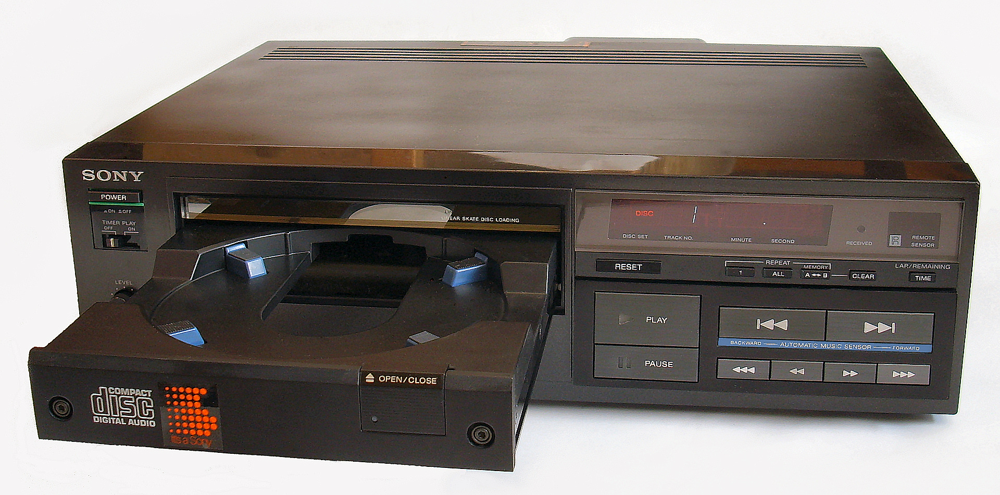
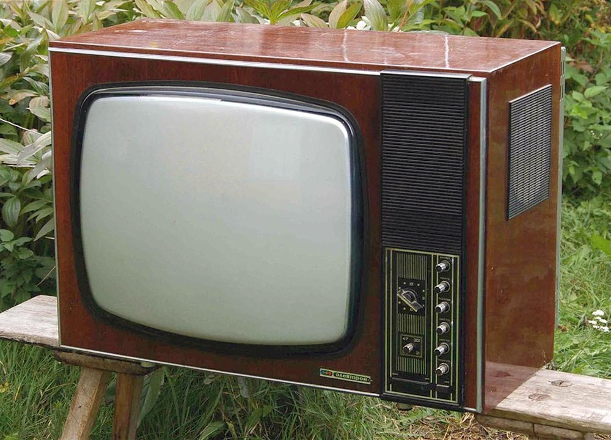
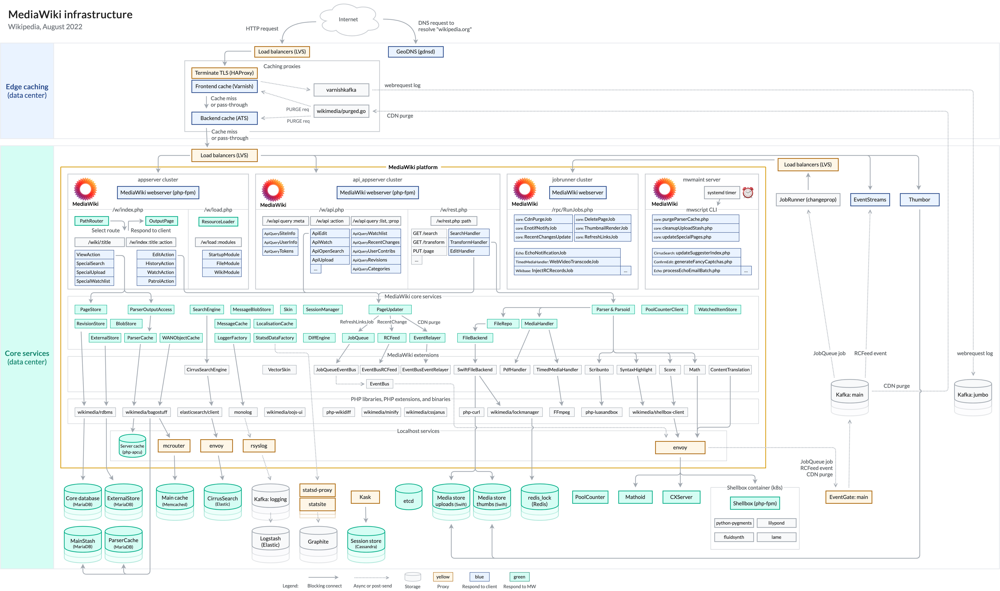
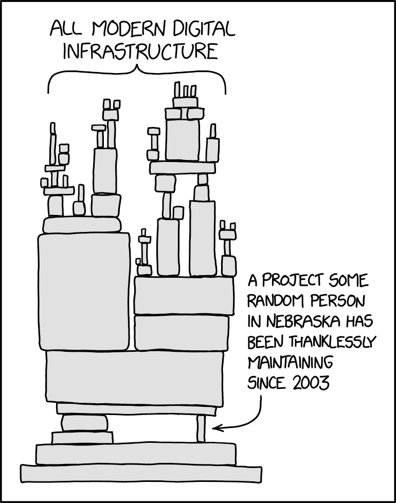
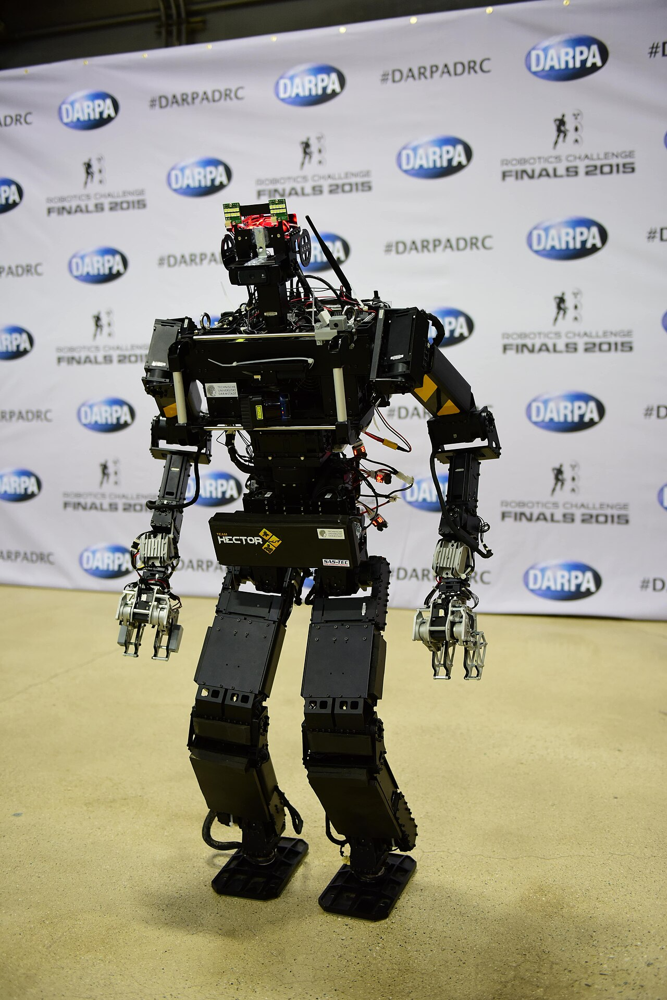

## Why Do We Care About Code?

<small>Although it's 2026?</small>

---

<!--
* Got interested in tech in the 80ies, tinkering with electronics -> CD “the most complex technical system since color tv”
* Today’s PoV: really?
-->

  <figure class="slide-img fragment fade-out" data-fragment-index="1">
    
    <figcaption class="img-credit">Sony CDP-101, the first commercial CD player, 1982 – Photo: Atreyu, <a href="https://commons.wikimedia.org/wiki/File:CDP101a.jpg">Wikimedia Commons</a>, CC BY 3.0</figcaption>
  </figure>
  <figure class="slide-img fragment fade-in" data-fragment-index="1">
    
    <figcaption class="img-credit">Elektron-706 colour TV, 1973 – Photo: Valery Kharchenko, <a href="https://commons.wikimedia.org/wiki/File:Elektron706.jpg">Wikimedia Commons</a>, CC0</figcaption>
  </figure>

---

<!--
* Every single software system today is way more complicated
* Complexity of everyday systems skyrocketed within the lifetime of a human
-->

<figure class="slide-img">
  
  <figcaption class="img-credit">MediaWiki infrastructure (Wikipedia), August 2022 – Timo Tijhof, <a href="https://commons.wikimedia.org/wiki/File:MediaWiki_infrastructure_2022.png">Wikimedia Commons</a>, CC0</figcaption>
</figure>

---

### How did we manage to reach this?
<small>Software is supposed to be soft</small>

  <ul>
    <li>Increased hardware capabilities</li>
    <li>Easy to copy</li>
    <li>We build our own tools</li>
    <li>Abstractions</li>
    <li>Small increments</li>
    <li>Feedback</li>
    <li>A lot of users</li>
  </ul>
  <figure class="slide-img">
    
    <figcaption class="img-credit">Photo: João Estevão A. de Freitas, <a href="https://commons.wikimedia.org/wiki/File:A_single_white_feather_closeup.jpg">Wikimedia Commons</a>, public domain</figcaption>
  </figure>

<!--
* It's software
  * at first sight: it is easy to change and has no weight
  * we know: that's not really true
    * Hardware has to support this
    * Too much to understand everything by a single human
    * Effects of changes are hard to foresee
-->

---

### Complexity
<figure class="slide-img">
  
  <figcaption class="img-credit">“Dependency” – Randall Munroe, <a href="https://xkcd.com/2347/">xkcd.com/2347</a>, CC BY-NC 2.5</figcaption>
</figure>

<!--
* Looking back to evolution of software
  * Production
    * Firmware (BIOS)
    * Operating Systems
    * Libraries
    * Runtimes
    * Garbage Collection
    * JIT-Compilers
    * Malware Scanners
    * Virtualization
    * Orchestration
    * Observability
  * Development
    * Assemblers
    * Compilers - Languages
      * Typing
      * Paradigms
    * Linkers
    * Frameworks
    * Libraries
    * Linters
    * IDEs
    * Test-Tools
    * Source Control
  * Inbetween
    * Testing Frameworks
    * Vulnerability checkers
    * SBOM
    * Build Pipelines
    * GitOps
* This is going to evolve and change further.
* But it will also be around in one form or another
-->

---

### What Our Users Care About
<small>and what we get paid for</small>

* Is defined in our code
* Is expressed in our code
* Has to be changed in our code

---

### Agentic coding

  <ul>
    <li>Might spare us the details</li>
    <li>Still needs managing</li>
    <li></li>
    <li class="fragment">Produces so much code</li>
    <li class="fragment">Needs even more managing!</li>
    <!-- <li>Speed is way beyond human comprehension
      <ul>
        <li>How do we know it works?</li>
        <li>Do we still care about maintainability?</li>
      </ul>
    </li> -->
  </ul>
  <figure class="slide-img">
    
    <figcaption class="img-credit">Humanoid robot “Johnny 05”, DARPA Robotics Challenge 2015 – Photo: DARPA, <a href="https://commons.wikimedia.org/wiki/File:Roboter_Johnny_05_DARPA_Robotics_Challenge_2015_compressed.jpg">Wikimedia Commons</a>, public domain</figcaption>
  </figure>

---

### What Our Users Care About
<small>and what we get paid for</small>

* Is defined in our code
* Is expressed in our code
* Has to be changed in our code

That's why we care about it!

