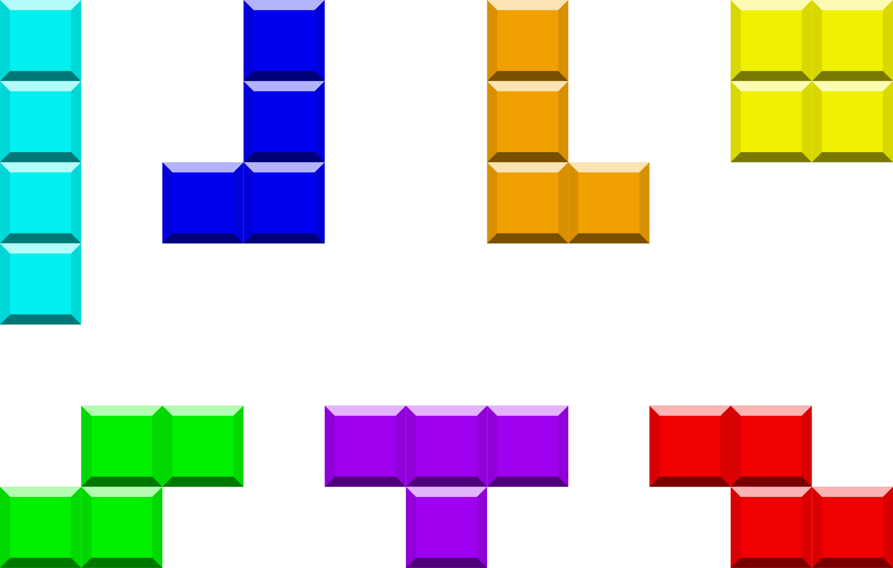

# Session 1

Focus: Understanding the Domain

Facilitator: Christoph Kober [@kober@hachyderm.io](https://hachyderm.io/@kober)

---

## Tetris

- A tile-matching puzzle where
- players manipulate falling blocks
- to complete horizontal lines on a vertical grid.

*Who played Tetris?*

---

### Tetris Details

- The seven **tetrominoes** are I, J, L, O, S, T, and Z
- In the grid, usually 10 wide and 20 tall, tetrominoes fall from the top and are placed at the bottom.
- When a row is completely filled, it clears, causing the blocks above it to shift downward.
- Players control tetrominoes' horizontal movement and rotate them to fit better into spaces.
- The game ends when a new tetromino can no longer fit into the grid because the stack of blocks has reached the top.

---

### The seven Tetrominoes

---

## Pen & Paper Session 📝

- With a partner and only pen & paper (**#nocomputer**)
- Build a common understanding of the game and its rules
- Find the **building blocks** this game consists of
- Find which **intermediate releases** would make sense before you arrive at the full game implementation

---

## Retrospective 🏟️

- Did you find **building blocks** you didn't expect before?
- Which **slices** (= intermediate releases) did you identify?
- What is the **relationship** between building blocks and slices?

---

## Enjoy the Break ☕

*And be back in 10 minutes.*
