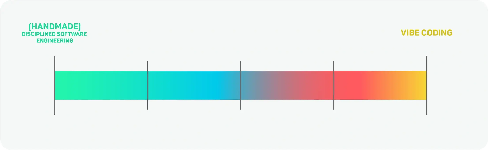

## Session 5

Focus: Staying in the Loop

Facilitator: Claus Aichinger

---

---

### Disciplined Software Engineering 🧰

**Managing complexity** using specific strategies:
* Process: taking a break, small steps, TDD, ...
* Modelling: pen & paper, MVPs, ...
* Design: interfaces, domain types, ...

**Managing complexity** is a **human requirement**:

> So that we can reason about our code.

---

> How can we manage complexity while delegating? 🏗️

---

<svg viewBox="0 0 640 420" width="100%" style="font-family: sans-serif; font-size: 18px;">
  <defs>
    <marker id="bb1" markerWidth="10" markerHeight="10" refX="8" refY="5" orient="auto">
      <path d="M0,0 L10,5 L0,10 z" fill="currentColor"/>
    </marker>
  </defs>
  <line x1="70" y1="360" x2="620" y2="360" stroke="currentColor" stroke-width="2" marker-end="url(#bb1)"/>
  <line x1="70" y1="360" x2="70" y2="20" stroke="currentColor" stroke-width="2" marker-end="url(#bb1)"/>
  <text x="345" y="404" text-anchor="middle" fill="currentColor">Autonomy →</text>
  <text x="22" y="190" text-anchor="middle" fill="currentColor" transform="rotate(-90 22 190)">Structure →</text>
  <line x1="110" y1="50" x2="580" y2="330" stroke="currentColor" stroke-width="2" opacity="0.4"/>
  <circle cx="110" cy="50" r="9" fill="currentColor"/>
  <text x="128" y="30" fill="currentColor">HANDMADE</text>
  <circle cx="580" cy="330" r="9" fill="currentColor"/>
  <text x="560" y="335" text-anchor="end" fill="currentColor">VIBE CODING</text>
</svg>

<!--
Naive assumption: more structure means less autonomy (the line).

Our interest (the shaded area): structure that buys autonomy
without losing the loop. Cf. EXACT: good tests and types
let you give the agent more room.
-->

---

### Structure 🧩

What *you* provide up front

**Behavior**

> Prose → examples → a test

**Design**

> Glossary → domain types → interfaces

---

### Autonomy 🤖

How much the agent does between *your* checkpoints

**When** do you stop?

> Every step → every cycle → the whole slice

**What** do you look at?

> The diff → the tests → the running behavior

<!--
Intention: make the choices we usually make implicitly explicit.
Examples should be familiar, so they follow the naive line:
more structure, tighter checkpoints. Later we break with that.
-->

---

### Complexity Managed ❓ ↔ Verifiability ✅

At any point, you can:

1. **Explain & defend the design** on a whiteboard
   > Building blocks, how they collaborate, why they are shaped this way
2. **Approve the tests** as your acceptance criteria
   > Human readable: "this is what *correct* means"

> Let's call that "staying in the loop".

---

### Exploration 🧪

<svg viewBox="0 0 640 420" width="100%" style="font-family: sans-serif; font-size: 18px;">
  <defs>
    <marker id="bb2" markerWidth="10" markerHeight="10" refX="8" refY="5" orient="auto">
      <path d="M0,0 L10,5 L0,10 z" fill="currentColor"/>
    </marker>
  </defs>
  <polygon points="110,50 580,50 580,330" fill="currentColor" opacity="0.12"/>
  <line x1="70" y1="360" x2="620" y2="360" stroke="currentColor" stroke-width="2" marker-end="url(#bb2)"/>
  <line x1="70" y1="360" x2="70" y2="20" stroke="currentColor" stroke-width="2" marker-end="url(#bb2)"/>
  <text x="345" y="404" text-anchor="middle" fill="currentColor">Autonomy →</text>
  <text x="22" y="190" text-anchor="middle" fill="currentColor" transform="rotate(-90 22 190)">Structure →</text>
  <line x1="110" y1="50" x2="580" y2="330" stroke="currentColor" stroke-width="2" opacity="0.4"/>
  <line x1="345" y1="190" x2="345" y2="95" stroke="currentColor" stroke-width="3" marker-end="url(#bb2)"/>
  <line x1="345" y1="190" x2="345" y2="285" stroke="currentColor" stroke-width="3" marker-end="url(#bb2)"/>
  <line x1="345" y1="190" x2="455" y2="190" stroke="currentColor" stroke-width="3" marker-end="url(#bb2)"/>
  <line x1="345" y1="190" x2="235" y2="190" stroke="currentColor" stroke-width="3" marker-end="url(#bb2)"/>
  <circle cx="110" cy="50" r="9" fill="currentColor"/>
  <text x="128" y="30" fill="currentColor">HANDMADE</text>
  <circle cx="580" cy="330" r="9" fill="currentColor"/>
  <text x="560" y="335" text-anchor="end" fill="currentColor">VIBE CODING</text>
  <circle cx="345" cy="190" r="14" fill="currentColor"/>
  <text x="345" y="80" text-anchor="middle" fill="currentColor" font-size="16">more structure</text>
  <text x="345" y="310" text-anchor="middle" fill="currentColor" font-size="16">less structure</text>
  <text x="465" y="196" fill="currentColor" font-size="16">more autonomy</text>
  <text x="225" y="196" text-anchor="end" fill="currentColor" font-size="16">less autonomy</text>
</svg>

> Start somewhere, then adjust to stay in the loop.

---

### Options 🧩 🤖

| |  |  |  |
|---|---|---|---|
| **Structure** <small>what you provide</small> | Prose | Examples or an acceptance test | Plus glossary, types, interfaces |
| **Autonomy** <small>what the agent does before you check</small> | One test | One example or small feature | The whole slice |

<!--
Suggested default start (not prescribed): Structure 2, Autonomy 1.
-->

---

### Rule 👀

**Lost the loop?**
* Revert
* Tighten: less autonomy *or* more structure

**Solid?**
* Commit
* Loosen: more autonomy *or* less structure

> What went wrong? What kind of change is needed?

<!--
Note: "dial up/down" is ambiguous (structure up = tighter, autonomy up = looser),
hence tighten / loosen.
Tightening by adding structure keeps autonomy: the shaded area.
Should we hint at that, or leave it open?
-->

---

### How to Start ⏯️

* Choose a subset/slice you are interested in
* Choose where to start on the menu

### How to Iterate 🎚️

* Apply the in-the-loop-rule
* Take note whenever you move a dial:
  * From, to
  * And why?

---

## Retrospective 🎪

* How did you approach your exploration?
* Did you stay in the loop?
* What did you observe?

<!--
* Did you end up with deliberate delegation or cognitive surrender?
-->
